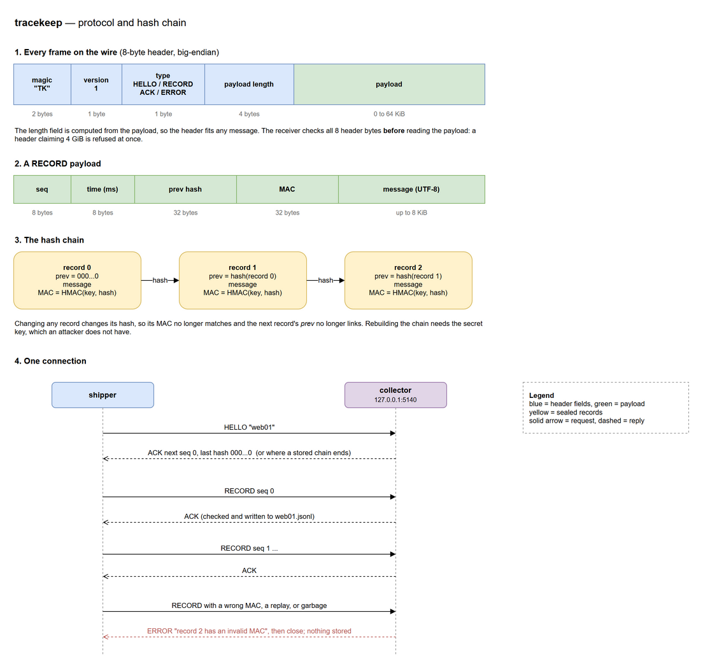
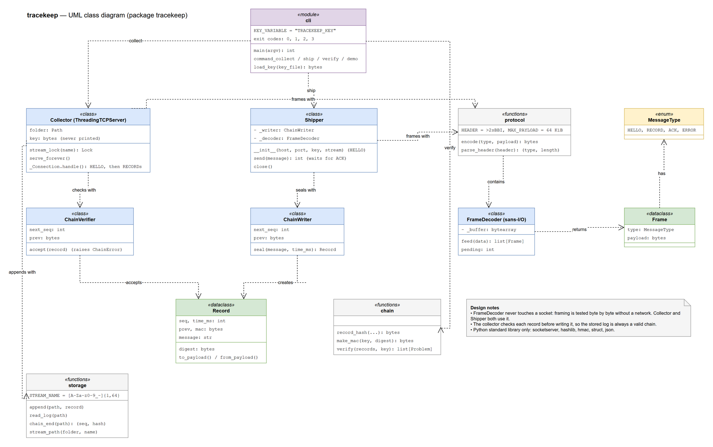

# tracekeep

Tamper-evident log shipping over TCP, in Python: log lines are sent to a collector as a **hash chain signed with a secret key**, so if anyone later edits, deletes, reorders or forges a line, `verify` points to the exact record.

> **A demonstration project.** Every example, test and the built-in `demo` command use fake log lines and IP addresses from the documentation ranges of RFC 5737, which belong to nobody.

## Overview

### What

Three small commands and one custom TCP protocol:

- **`ship`** sends log lines to a collector, each sealed into a chain.
- **`collect`** receives them, checks every record before storing it, and appends it to a log file.
- **`verify`** checks a stored log, offline, and lists every place it was tampered with.

```
> python -m tracekeep verify logs/web01-tampered.jsonl
web01-tampered.jsonl: 6 records, 3 problems found:
  line    3  altered       record 2 was changed or forged: its MAC does not match
  line    5  missing       1 record missing before record 5
  line    6  altered       record 6 was changed or forged: its MAC does not match
```

### Problem

Logs are the evidence of what happened on a machine, so they are the first thing an intruder changes: delete the line that shows their login, edit the IP address, or clear the whole log. A plain text log cannot tell you it was changed, and a backup only helps if you notice in time.

Shipping logs to another machine helps, but it raises two more questions: did every line arrive, and was any line changed on the way or after it was stored?

### Solution

- **A hash chain:** every record contains the SHA-256 hash of the record before it. Changing any record breaks every link after it, so a change cannot hide in the middle.
- **An HMAC on every record:** a plain hash chain can be rebuilt by anyone who edits the file. Each record is also signed with HMAC-SHA256 and a secret key, so without the key a rebuilt or forged chain fails verification.
- **Checking on arrival:** the collector checks each record's signature, sequence number and link **before** writing it, and refuses anything forged, replayed or out of order with a reason. The stored log only ever holds a valid chain.
- **A custom binary protocol:** an 8-byte header (`TK`, version, type, payload length) in front of every message. The length field is computed from the payload, so the header fits any message, and it tells the receiver exactly where each message ends in the TCP byte stream.
- **Precise reports:** `verify` keeps going after a problem and says exactly what kind it is (altered, missing, duplicate, out of order), once per problem, with the line number.

### Why I built it

To understand integrity protection and protocol design from the ground up, the parts that tools like syslog-over-TLS and tamper-proof audit logs are built on:

| Concept | Where it lives |
|---|---|
| Designing a binary protocol: header, versioning, message types | `protocol.py` |
| TCP framing: messages split across reads or glued together | `FrameDecoder` in `protocol.py` |
| Defensive parsing: refusing a hostile header before reading its payload | `parse_header` |
| Hash chains and HMAC; constant-time comparison | `chain.py` |
| Replay, reordering and deletion detection with sequence numbers | `ChainVerifier`, `verify` |
| Path traversal prevention for names that come from the network | `storage.py` |
| A threaded TCP server with per-stream locking | `collector.py` |
| Testing networked code with real sockets on localhost | `tests/test_network.py` |
| Store and forward: write-ahead spooling, fsync, atomic state files, resuming without duplicates | `tracekeep/spool.py`, `SpoolingShipper` |

### Part of a project series

Each project looks at the same network from a different side:

| Project | Language | View | Question it answers |
|---|---|---|---|
| [**portscout**](https://github.com/AoceanP/portscout) | Java 21 | the attacker's view | What ports are open, and what is running behind them? |
| [**wiresight**](https://github.com/AoceanP/wiresight) | C++20 | the network's view | What is actually on the wire? |
| [**logonwatch**](https://github.com/AoceanP/logonwatch) | C# / .NET 10 | the defender's view | Is someone trying to break in, and did they get in? |
| **tracekeep** (this one) | Python | the evidence's view | Can the logs still be trusted afterwards? |

logonwatch finds the attack in the logs; tracekeep makes sure nobody can quietly rewrite those logs afterwards. And because tracekeep sends a documented protocol over plain TCP, wiresight can capture it on the loopback adapter and show every HELLO, RECORD and ACK.

## Setup

### 1. Install the requirements

- **Python 3.10 or newer.** Check with `python --version`.
- Nothing else: tracekeep uses only the Python standard library (`socketserver`, `hashlib`, `hmac`, `struct`, `json`).

### 2. Get the code

```
git clone https://github.com/AoceanP/tracekeep.git
cd tracekeep
```

No install step: everything runs with `python -m tracekeep` from this folder.

### 3. Run the tests

```
python -m unittest discover -s tests -t .
```

It ends with `Ran 59 tests ... OK`.

### 4. Try the demo

```
python -m tracekeep demo
```

It starts a collector on `127.0.0.1`, ships six fake log lines, verifies them, then edits, deletes and forges lines in a copy and shows `verify` catching each change. Everything happens in a temporary folder that is deleted afterwards.

### 5. Use it for real

Set a shared key (at least 16 characters) in the environment, in **two** terminals:

| Windows (PowerShell) | Linux / macOS |
|---|---|
| `$env:TRACEKEEP_KEY = "choose-a-long-random-key"` | `export TRACEKEEP_KEY="choose-a-long-random-key"` |

Terminal 1, the collector:
```
python -m tracekeep collect --dir logs
```
Terminal 2, ship a log file, then verify what was stored:
```
python -m tracekeep ship app.log --stream app01
python -m tracekeep verify logs/app01.jsonl
```

Now open `logs/app01.jsonl` in a text editor, change one character in any message, and run `verify` again.

### Troubleshooting

- **`error: no key`:** set `TRACEKEEP_KEY` in that terminal, or pass `--key-file`. Each terminal needs it.
- **`could not connect to 127.0.0.1:5140`:** the collector is not running, or uses another `--port`.
- **`collector refused: record 0 has an invalid MAC`:** the shipper and collector have different keys.
- **`Address already in use`:** another program uses port 5140; pick another with `--port` on both sides.

## Usage

| Command | What it does |
|---|---|
| `collect [--dir DIR] [--host H] [--port P]` | receive records and store each stream in `DIR/STREAM.jsonl` (default `logs`, `127.0.0.1`, `5140`) |
| `ship FILE --stream NAME [--host H] [--port P]` | send each line of `FILE` (or `-` for standard input) as a record |
| `ship ... --spool DIR [--retry S] [--spool-limit N]` | the same, but keep lines in `DIR` while the collector is unreachable and send them when it is back (store and forward) |
| `verify FILE` | check a stored log and list every problem |
| `demo` | the full story with fake data, in a temporary folder |
| `demo --outage` | stop and restart a real collector mid-stream, to show store and forward |

Every command takes `--key-file FILE` instead of the `TRACEKEEP_KEY` variable.

**Exit codes:** `0` success (for `verify`: the chain is intact), `3` `verify` found tampering, `1` error, `2` bad command line, the same scheme as logonwatch.

**Stream names** are 1 to 64 letters, digits, `_` or `-`. Each stream is its own chain and its own file. A shipper that reconnects continues its stream's chain where it ended.

### Store and forward

Without `--spool`, a line that cannot be delivered is an error. With it, an outage costs nothing:

```
tracekeep ship - --stream web01 --spool spool
```

- **Write-ahead:** every line is sealed, written to `spool/web01.spool.jsonl` and synced to disk *before* it is sent. A crash at any moment loses nothing that was read.
- **Sealed while waiting:** records are sealed when the line arrives, not when they are delivered. Their time is when the line was written, and a record edited on disk while it waits is refused by the collector (invalid MAC).
- **Back in order:** while the collector is down, a reconnect is tried at most every `--retry` seconds (default 5). Once it answers, the waiting records go out oldest first, then the spool is emptied.
- **No duplicates after a crash:** if the shipper crashed after the collector stored records but before clearing them, the collector's HELLO says where its chain ends. Those records are skipped, after checking the chain really ends at them.
- **Never merged, never dropped:** if the collector's chain does not continue the spool (someone else wrote the stream meanwhile), shipping stops and the spool is kept as is. Re-sealing would destroy the proof. A full spool (`--spool-limit`, default 100,000 records) also stops with an error, because dropping the oldest records would cut the chain.
- **The first run needs the collector,** to learn where the stream's chain stands. After that the chain end is kept in `spool/web01.state.json`, so the shipper can start during an outage.

```
> tracekeep demo --outage
1. collector up on 127.0.0.1:61445; shipping 2 lines
   waiting in the spool: 0

2. the collector stops; shipping 3 more lines
   collector unreachable: 3 records sealed and waiting in web01.spool.jsonl

3. the collector restarts on the same port; shipping 1 more line
   waiting in the spool: 0

4. verifying the collector's log: the outage left no gap
web01.jsonl: 6 records, chain intact
```

On Windows a refused connection takes about **2 seconds** to fail (Windows retries before giving up), so every reconnect attempt pauses the shipper that long. That is why attempts are spaced by `--retry` instead of made for every line.

**The stored format** is one JSON object per line, readable in any editor:
```
{"seq": 0, "time": "2026-10-21T10:00:00.000Z", "message": "sshd: Failed password for admin from 203.0.113.7", "prev": "0000…", "mac": "e318…"}
```

## The protocol



| Type | Direction | Payload |
|---|---|---|
| `HELLO` (1) | shipper to collector, first frame | the stream name |
| `RECORD` (2) | shipper to collector | sequence (8 B), time in ms (8 B), previous hash (32 B), MAC (32 B), message (UTF-8, up to 8 KiB) |
| `ACK` (3) | collector to shipper | next expected sequence (8 B) and last hash (32 B) |
| `ERROR` (4) | collector to shipper | the reason, then the connection closes |

Each record's hash is `SHA-256(prev ‖ seq ‖ time ‖ message)` and its MAC is `HMAC-SHA256(key, hash)`. Fixed-size fields come first and the message last, so two different records can never hash the same bytes.

## Privacy and security

- **Integrity, not secrecy:** tracekeep proves logs were not changed; it does **not** encrypt them. Anyone who can see the traffic can read the log lines (wiresight shows them). For logs over a real network, add TLS: see the roadmap.
- **The key is everything:** anyone with the key can write valid records. It is read from an environment variable or a file, never from the command line (where other users can see it) and never printed. The demo's key is public and only for the demo.
- **The spool is on the shipper's disk:** waiting records are sealed, so changes to them are caught, but they are not encrypted, and a spool can be deleted by anyone who can delete the original log. Protect the spool folder like the log it holds.
- **Local by default:** the collector listens on `127.0.0.1`, so it is not reachable from the network unless you pass `--host` on purpose.
- **What the chain cannot show by itself:** if someone deletes the **last** records of a log, the remaining chain is still valid. The collector tells the shipper the latest hash in every ACK; keeping that value somewhere else (another machine, a printout) lets you prove nothing was cut off the end. Anchoring it automatically is on the roadmap.
- `.gitignore` blocks `logs/`, `*.jsonl` and key files.

## How it works

1. **Ship:** `ChainWriter.seal` gives each line the next sequence number, links it to the previous hash, and signs it. The shipper sends it in a RECORD frame and waits for the ACK before sending the next one, so a line is only reported as sent once it is stored.
2. **Frame:** the header's length field is computed from the payload. On the other side, `FrameDecoder.feed` takes whatever bytes `recv()` returned and only returns whole frames, however TCP split them. It checks each header before waiting for its payload, so a header claiming 4 GiB is refused straight away.
3. **Collect:** each connection runs on its own thread. The first frame must be HELLO with a valid stream name; the collector answers with where that stream's chain ends. Every RECORD is checked by `ChainVerifier` (MAC first, compared in constant time; then sequence; then link) under that stream's lock, appended, and only then acknowledged.
4. **Verify:** `verify` walks the whole file. It reports a bad MAC as **altered**, a gap as **missing** (only if the record is nowhere in the file), a repeated record as **duplicate**, and one going backwards as **out of order**, then re-synchronises on the next record so one problem never hides another, and never reports the same cause twice.

## Design

### UML class diagram



Both diagrams are drawn in draw.io: [tracekeep-protocol.drawio](docs/tracekeep-protocol.drawio) and [tracekeep-uml.drawio](docs/tracekeep-uml.drawio).

## Tests

59 tests with Python's built-in `unittest`, run with `python -m unittest discover -s tests -t .`. The network tests start a real collector on `127.0.0.1` on a free port, in a temporary folder that is deleted afterwards.

| File | What it covers |
|---|---|
| `test_protocol.py` | the length field at every size, frames split byte by byte or glued together, every bad header |
| `test_chain.py` | edits, deletions, swaps, duplicates, forged and rebuilt chains, the wrong key, payload checks |
| `test_network.py` | shipping, reconnecting, separate streams, wrong keys, replays, path traversal, garbage, half frames |
| `test_storage_and_cli.py` | the file format, stream names, the demo, exit codes, missing keys, files and collectors |
| `test_spool.py` | store and forward against a collector that is really stopped and restarted: outages, restarts of either side, a crash between an ACK and clearing the spool, a conflicting chain, a spool edited on disk, a full spool, the retry interval |

## Roadmap

- [x] Binary protocol, hash chain with HMAC, collector, shipper, offline verify
- [x] Store and forward: keep shipping through collector outages
- [ ] TLS, so log lines are also kept secret on the network
- [ ] Anchor the latest hash automatically (e.g. to a second collector), to detect a truncated end
- [ ] Key rotation, with the key's ID stored in each record
- [ ] Ship Windows events straight from logonwatch's JSON-lines output

## License

MIT, Copyright (c) 2026 AoceanP. See [LICENSE](LICENSE).

## Edge cases

Every case below is covered by a test.

### Tampering (`test_chain.py`, `test_storage_and_cli.py`)

| Change to a stored log | Reported as | Why |
|---|---|---|
| One message edited | **altered**, at that line only | its MAC no longer matches; the next record's broken link is explained by it, so not reported twice |
| A record deleted from the middle | **missing**, naming the gap | the sequence numbers jump |
| Two records swapped | **out of order** | nothing is missing, so no false "missing" |
| A record copied right after itself | **duplicate** | a replayed entry, e.g. a second "payment sent" |
| A new record added without the key | **altered** | the format and links can be copied, the MAC cannot |
| The whole log rewritten and re-linked without the key | every record **altered** | the attack a plain hash chain cannot stop |
| Verified with the wrong key | every record **altered** | verification means nothing without the right key |
| A line that is not a record at all | **unreadable** | reported, and checking continues |
| One character changed by hand in an editor | **altered**, exit code 3 | the realistic case |

### Protocol and network (`test_protocol.py`, `test_network.py`)

| Input | Result | Why |
|---|---|---|
| Payloads of 0, 1, 1000 and 65,536 bytes | length field always right | the header adapts to the message |
| Two frames sent one byte at a time | both decoded correctly | TCP can split anywhere |
| Three frames in one read | all three, in order | TCP can also glue messages together |
| A header claiming 4 GiB | refused after 8 bytes | never waits for or allocates the payload |
| Wrong magic, version 2, type 99 | refused at the header | not a tracekeep frame |
| A web request or random text sent to the port | `bad magic` error, no crash | e.g. a browser or a port scanner |
| A record before HELLO | error | the handshake order is enforced |
| A record with the wrong key | refused, nothing stored | only key holders can write |
| A valid record sent twice | the second refused: `expected record 1, got 0` | a captured record cannot be replayed |
| Stream names `../evil`, `..\evil`, `a/b`, empty, 65 characters, `web01.jsonl` | refused | the name becomes a file name (path traversal) |
| A client that sends half a frame and hangs up | the collector carries on | one broken client cannot stop others |
| Two streams at the same time | separate files and chains | per-stream locks |
| A shipper reconnecting | continues the chain at the next number | the chain survives restarts |
| A message over 8 KiB, invalid UTF-8, or a time after the year 9999 | refused | checked before it can reach the disk |
| A key shorter than 16 bytes | refused | a short key could be guessed |

### Command line (`test_storage_and_cli.py`)

| Command | Result |
|---|---|
| `verify` on an intact log | `chain intact`, exit 0 |
| `verify` on a changed log | the problems, exit 3 |
| No key set | `error: no key: set the TRACEKEEP_KEY environment variable or pass --key-file`, exit 1 |
| `verify no-such-file.jsonl` | `error: ...`, exit 1 |
| `ship` with no collector running | `error: could not connect to 127.0.0.1:...`, exit 1 |
| An unknown command, or `ship` without `--stream` | usage message, exit 2 |
